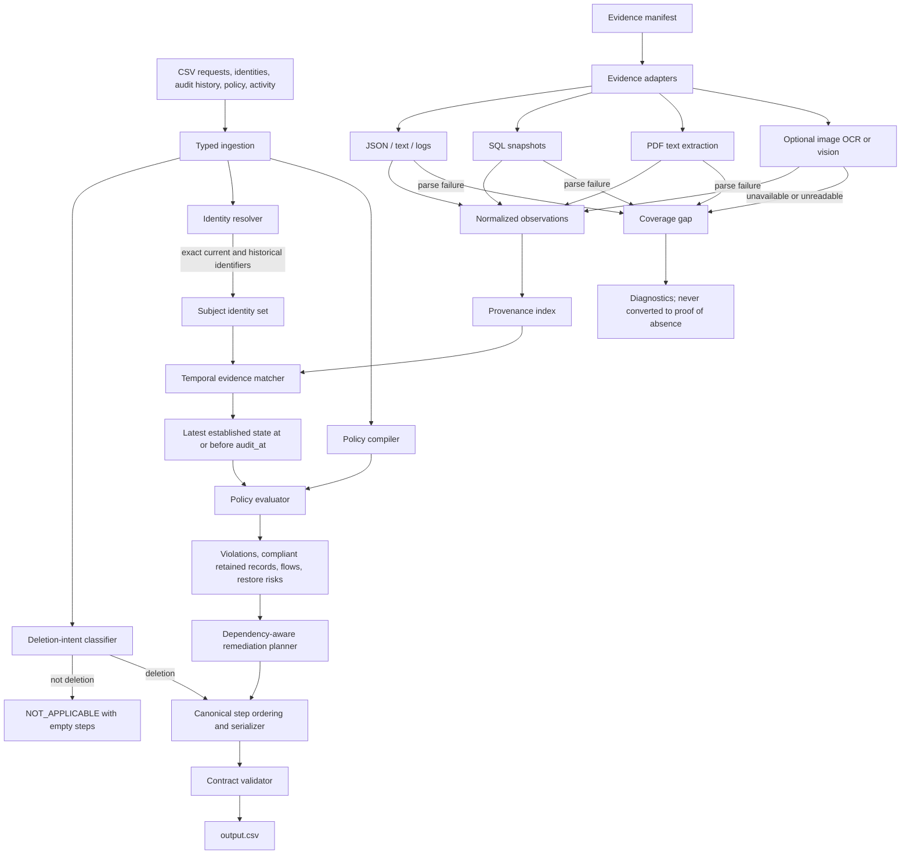
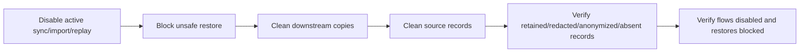

# Ghost Data Still Exists — Architecture

## Objective

Produce a deterministic, evidence-backed deletion audit for every request at its
`audit_at` cutoff. Reported workflow results are treated as claims. Production
inference uses only participant-facing files under `dataset/`.

## Flow

## Deterministic core

1. **Ingestion** parses timestamps as UTC and validates required schemas.
2. **Intent** recognizes deletion language and explicit non-deletion intents;
   ambiguous requests fail closed into diagnostics rather than being inferred
   from workflow status.
3. **Identity resolution** joins request email to current or historical email
   values using normalized exact matching. It then expands only evidence-backed
   aliases from the same stable `user_id`. Names and shared phone numbers do not
   merge identities.
4. **Evidence normalization** emits typed observations with `system_id`,
   `resource_id`, data category, observed state, observation time, identifiers,
   fields relevant to policy, and full provenance (`file_id`/activity/audit ID,
   path, record or line location).
5. **Temporal reconstruction** considers only evidence available at or before
   `audit_at`, orders observations by their actual observation/event time, and
   selects the latest established state per resource. A successful activity is
   not proof of resulting state unless corroborated by state evidence.
6. **Policy evaluation** maps normalized categories to `deletion_rules.csv`,
   checking DELETE, REDACT, ANONYMIZE, RETAIN, and tombstone requirements.
   Missing required retained records are violations when the evidence scope
   establishes that the record should exist.
7. **Process analysis** evaluates active connectors and restore permissions as
   first-class resources. Canonical risk-first ordering disables flows and
   blocks restores before record cleanup; records then follow the contract's
   operation/system/resource order.
8. **Serialization** uses the contract's phase/operation/system/resource order,
   renumbers steps consecutively, validates exact fields and allowed values,
   checks evidence IDs, and confirms one sorted row per request.

## AI boundary

AI is not needed for structured CSV, JSON, SQL, or key-value logs. An optional
adapter may be used for screenshots, difficult scanned documents, or genuinely
ambiguous request language. Its output must validate against the same typed
observation schema, quote a source location, cite participant-visible evidence,
and never override deterministic temporal or policy logic. The baseline records
an explicit coverage gap when that adapter is unavailable.

## Failure handling

- Parse and extraction failures are recorded with source and reason.
- Evidence captured after `audit_at` is excluded from the decision.
- Unresolved identity links are not promoted from weak name or phone matches.
- Missing observations are not proof that a resource is absent.
- Any emitted finding retains its source evidence ID and location internally.
- Output generation fails validation rather than writing a structurally invalid
  submission.

## Dependency order

## Evaluation

The labeled 32-case sample is treated as a public development benchmark and
scored separately from the unlabeled submission requests for status, exact
steps, step precision/recall, aligned fields, and sequence. Synthetic tests cover
identity collisions, historical aliases, recreation paths, mandatory retention,
conflicting temporal observations, and extraction failures. The unlabeled 518
requests are validated only for contract and coverage, never against fabricated
labels.
